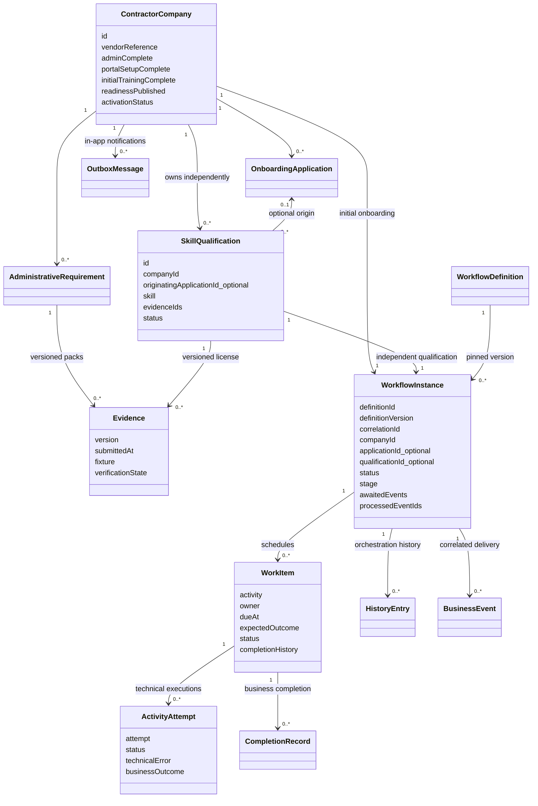
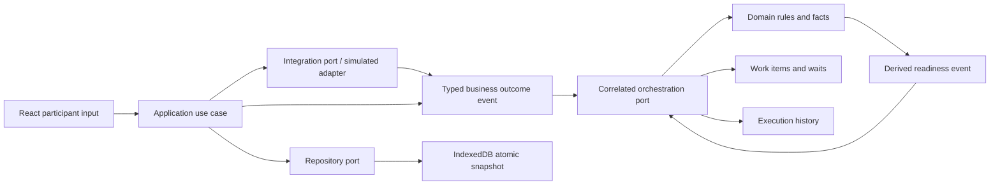

# Domain UML

The snapshot is a persistence unit, not a claim that all concepts form one production aggregate. Qualifications have no required application foreign key. Readiness comes from company facts plus approved company qualifications; readinessPublished records the last published result, not an activation override.

Iteration 3 adds a command coordination port around load, event processing and atomic save. Web Locks serialize commands across tabs; committed revision notifications cause read-only reloads in the three experiences. Domain relationships and workflow versions above are unchanged. See [shared-browser architecture](shared-browser.md).

Iteration 3.1 makes historical application Completed/completedAt distinct from current readiness, operational Pending/Active/Suspended and isJobEligible (Ready AND Active). Post-completion company lifecycle signals have no WorkflowInstance delivery. WorkItem cancellation records superseded initial activation or retired legacy work; original workflow history and events are preserved.
