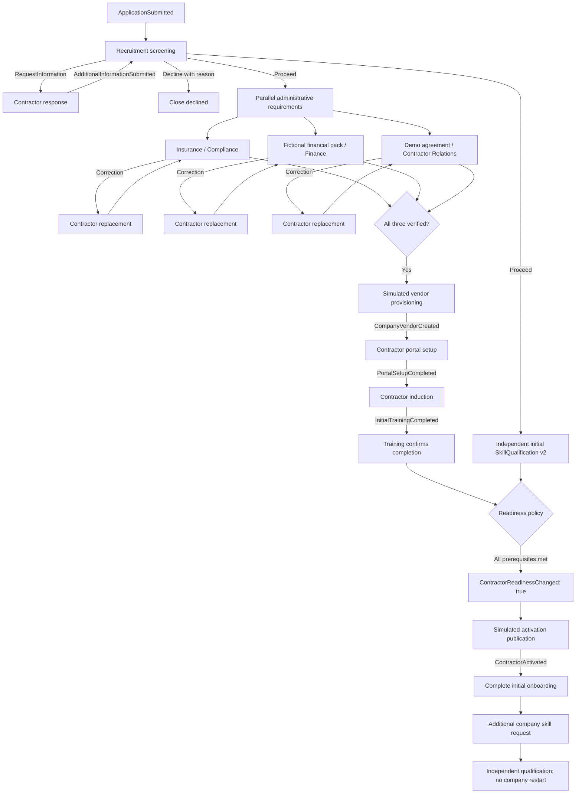
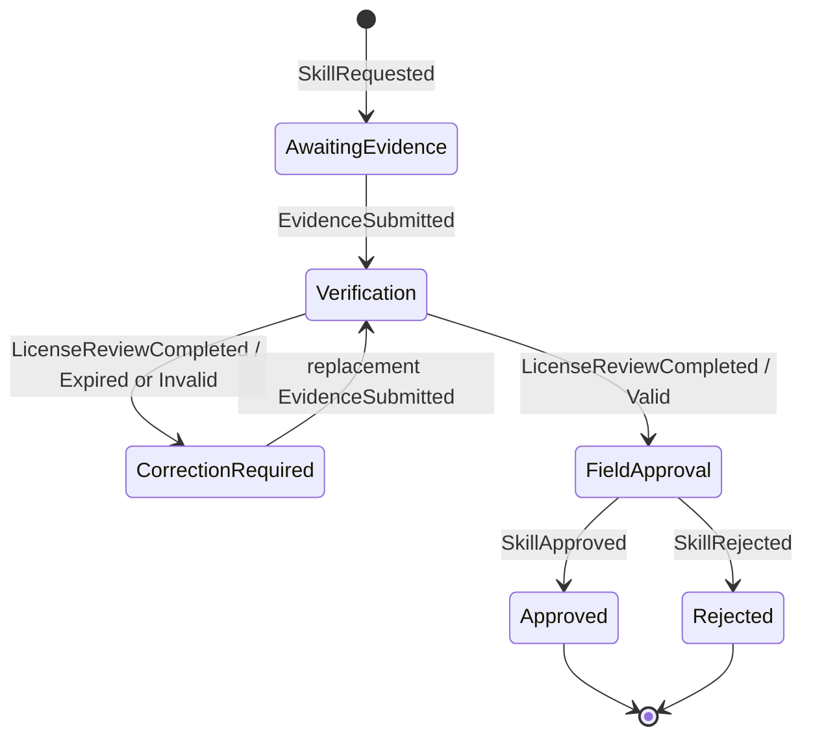

# Company onboarding process

CompanyOnboarding v2 starts once per application. Independent skill work starts after Recruitment proceeds. The company instance stays the same through information requests and administrative corrections.

Integration activities are explicitly run from the simulation panel. A timeout records a failed ActivityAttempt, emits no business outcome and leaves the task open. Retry uses the same task with another numbered attempt. Expired/incomplete evidence is a successful technical execution with a correction business outcome.

# Skill qualification process

Every qualification has an ID, correlation, tasks, evidence versions and execution history. Additional skills omit originatingApplicationId. Approval/rejection completes skill execution. Later explicit SkillInvalidated records against that historical qualification and recomputes company eligibility without reopening initial onboarding. Reinstatement is outside this iteration.

# Waiting and simulated timers

Work defines expected event, owner and subject. Multiple administrative tasks can await EvidenceSubmitted simultaneously; workItemId disambiguates them. Skill work uses a different correlation. A company with completed training but no approved skill waits for ContractorReadinessChanged.

The persisted clock starts at workspace creation and advances only on command. Human work is due after two demo days; reminder when due, escalation two days later. Each occurs once per open task. Timers create outbox/history records, never approvals or task completions.
