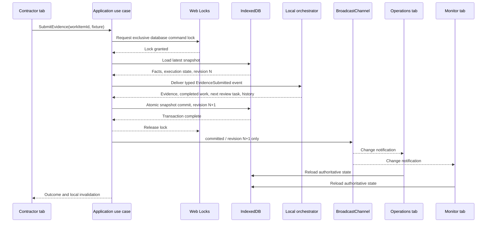

# Iteration 3: one state, three browser experiences

Company and skill processes, workflow definition versions, business events and readiness policy are unchanged. This iteration changes presentation and persistence coordination.

| Experience            | Route         | Presentation and actions                                                                                                  |
| --------------------- | ------------- | ------------------------------------------------------------------------------------------------------------------------- |
| Contractor Portal     | /#/contractor | Journey, required actions, contractor messages; applications, evidence, corrections, portal, induction, additional skills |
| Onboarding Operations | /#/operations | Internal role, overview, queues, internal outbox; review, approval, vendor and activation execution                       |
| Workflow Monitor      | /#/monitor    | Instances, events, rules, waits, attempts, recovery, timer and ingress demos                                              |

All routes share one app and IndexedDB. Company/role preferences use tab-local sessionStorage with experience-specific keys. No storage-event listener or cross-tab role propagation exists. Company selection is a demo convenience, not authentication.

## Command and notification sequence

Lock: `fieldwork-onboarding:commands:v1`. Channel: `fieldwork-onboarding:changes:v1`. Names derive from the database name for test isolation. Every command uses the coordination port, including ingress demos, timers, retry and migrations. There is no uncoordinated production fallback.

One `state` object-store transaction saves the entire snapshot under `current`. Save resolves only on transaction completion. Notification follows lock release. A newer command may commit before an older notification arrives: tabs always reload the repository and ignore snapshots older than their displayed revision. No business events or full snapshots travel over BroadcastChannel.

## Contention and recovery

- Two tabs reviewing different requirements reload serially under one lock, preserving both approvals.
- Two copies of one open task cannot both transition it. The second command reloads completed work and fails validation. Its UI reloads the queue and explains the stale action.
- EventId deduplication, correlation and expected-task checks remain inside the locked command. Duplicate/unrelated ingress does not increment revision.
- A timeout saves an ActivityAttempt while retaining open work. Retry from Operations or Monitor uses the same command and lock.
- Subscribers reload on change notification, focus, visible visibilitychange and pageshow. Lifecycle reload recovers messages missed while inactive; no refresh button or polling.
- Subscription begins before initialization. A local queue orders commands within a tab; the shared lock coordinates separate tab queues. No background dispatchers compete to process transitions.
- Missing secure context, Web Locks or BroadcastChannel disables writes with an explanation. Compatible saved state remains readable; old data is not migrated without the lock.

## Migration and compatibility

Database/store version and key are unchanged. Snapshot schema 3 adds revision. An Iteration 2 snapshot upgrades to revision 0 under lock, then commits revision 1. Initialization commits a revision even when business records are unchanged. Existing Iteration 1 migration also runs exclusively. Ordinary repository reads never perform workflow migrations.

Use identical scheme, host, port and Chrome profile. Different origins, profiles, browsers and devices are separate workspaces. Close tabs running a pre-Iteration-3 build; that code cannot honor the lock protocol. Storage remains browser-local and can be deleted or evicted.

## Test coverage

`npm test` retains prior domain, workflow and React participant scenarios. UI test navigation now follows real hash routes instead of reinstating the old all-persona selector. Explicit test coordinators support Node/jsdom; they are never runtime fallbacks.

`npm run test:browser` runs built static assets with multiple pages in the **same Chromium context**, checking:

1. The critical three-experience journey, expired-license correction, Ready and activation in all tabs without reload.
2. Contention: both UI commands wait behind the actual lock, then one screening transition commits. Independent concurrent reviews preserve both approvals.
3. Failure persistence, Monitor retry, continued Operations work and contractor refresh/reopening.
4. Revision-only notifications with already committed state available to read.
5. Missing locks and missing channel support both disable writes and save no business snapshot.
6. Independent roles/company selections and restoration after reload.
7. Recovery after deliberately dropped messages on visibility return. Headless pages remain individually visible, so the lifecycle test explicitly drives visibility events while using real IndexedDB, BroadcastChannel and Web Locks.

Generated screenshots and failure-only traces are ignored under test-results. Browser scenarios do not use developer endpoints, edit business snapshots or manually activate contractors.

## Iteration 3.1 addendum

The same database, Web Lock and revision notification protocol now persist snapshot schema 4. Migration repairs legacy reactivation work without rewriting original workflow execution history/events. All experiences show historical completion, derived readiness, operational status and Ready-plus-Active job eligibility separately. Later company lifecycle signals are not delivered to completed CompanyOnboarding. Three additional Chromium journeys verify rejection, suspension/restored readiness, immutable completed execution and cancellation before initial activation. See acceptance-3.1.md and STATUS.md.
